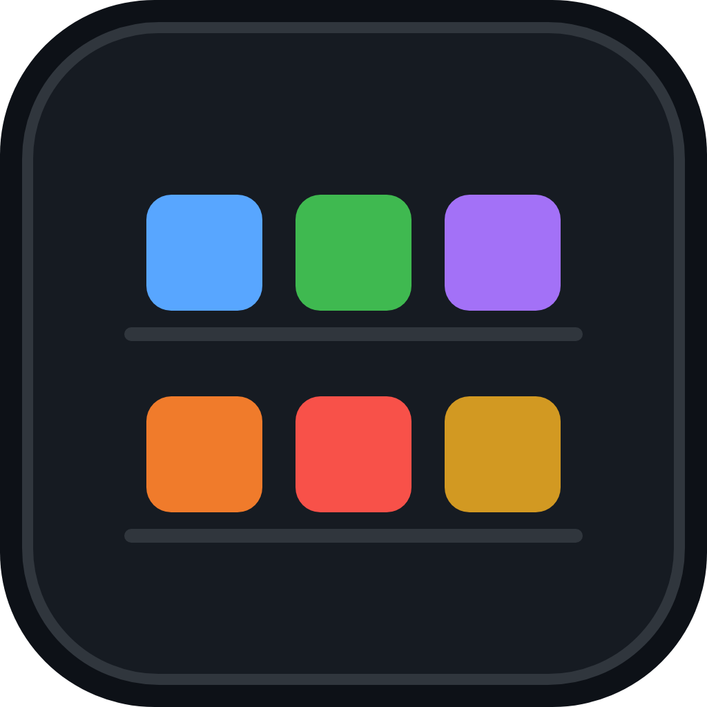
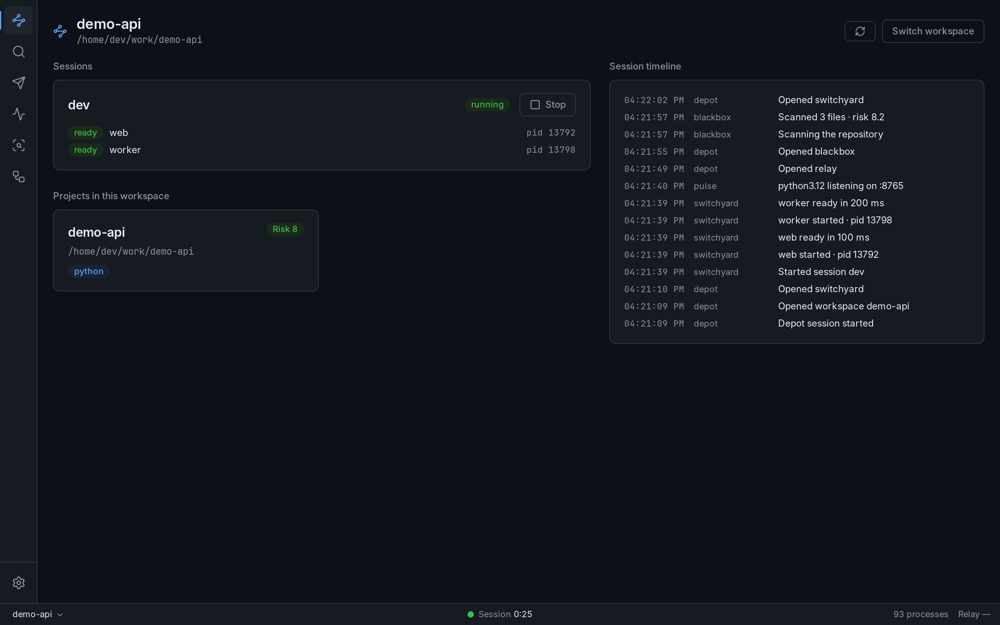

<div align="center">
  
  <h1>Depot</h1>
  <p><strong>A local-first developer environment.</strong></p>
  <p>
    <a href="https://github.com/purysho/Depot/actions/workflows/ci.yml"></a> ·
    <a href="https://github.com/purysho/Depot/releases"></a> ·
    <a href="LICENSE"></a> ·
    <a href="#download"></a>
  </p>
  <p>
    <strong>Download:</strong> <a href="#download">Windows</a> · <a href="#download">macOS</a> · <a href="#download">Linux</a> · <a href="#run-from-source">Run from source</a>
  </p>
</div>



Depot brings six standalone tools into one window with shared workspace context:

| Tool | What it does |
|---|---|
| [Switchyard](https://github.com/purysho/Switchyard) | Workspace orchestration, service graphs, run configs |
| [Needle](https://github.com/purysho/Needle) | Local file search and indexing |
| [Relay](https://github.com/purysho/Relay) | HTTP client, request inspector, mock server |
| [Pulse](https://github.com/purysho/Pulse) | Process and network relationship monitor |
| [BLACKBOX](https://github.com/purysho/BLACKBOX) | Repository forensics and code analysis |
| [Forge](https://github.com/purysho/Forge) | Workflow runner for local automations |

Each tool also ships as a standalone app. Depot adds the layer they cannot
provide alone: a workspace that scopes every tool to the current project, an
event bus that connects them, and a session timeline that records everything
that happened while you worked.

## Download

There is no release yet. Depot is in alpha: all six panels, the shared
workspace, the event bus with its five cross-tool links, and the session
timeline work, and are tested on Linux. Windows and macOS builds run in CI
but have not been tried by hand. Until the first release, run it from source
or use the standalone apps linked above.

| Platform | File |
|---|---|
| Windows 10/11 (x64) | First release pending — will appear on [Releases](https://github.com/purysho/Depot/releases) |
| macOS (Apple Silicon) | First release pending |
| Linux (x86_64) | First release pending |

## Run from source

Requirements: Node.js 22.12 or newer, Rust (stable), Python 3.10 or newer,
and the [Tauri system prerequisites](https://v2.tauri.app/start/prerequisites/)
for your platform (WebView2 on Windows, Xcode Command Line Tools on macOS,
WebKitGTK on Linux).

The six tools' own code is included as git submodules under `vendor/`:

```bash
git clone --recurse-submodules https://github.com/purysho/Depot.git
cd Depot
npm install
npm run tauri dev
```

In development Depot runs the tools through `python3` (`python` on Windows);
set `DEPOT_PYTHON` to use another interpreter.

Checks, as run in CI:

```bash
npm run typecheck
npm run lint
npm test
python -m unittest discover -s core/tests
cargo test --manifest-path src-tauri/Cargo.toml
```

To see every shared UI component, run `npm run dev` and open
`http://localhost:1420/#gallery`.

How it fits together: [docs/ARCHITECTURE.md](docs/ARCHITECTURE.md),
[docs/PLUGIN_PROTOCOL.md](docs/PLUGIN_PROTOCOL.md) and
[core/README.md](core/README.md).

## Contributing
See [CONTRIBUTING.md](CONTRIBUTING.md).

## License
MIT
